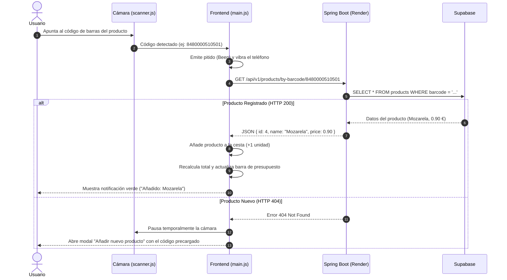
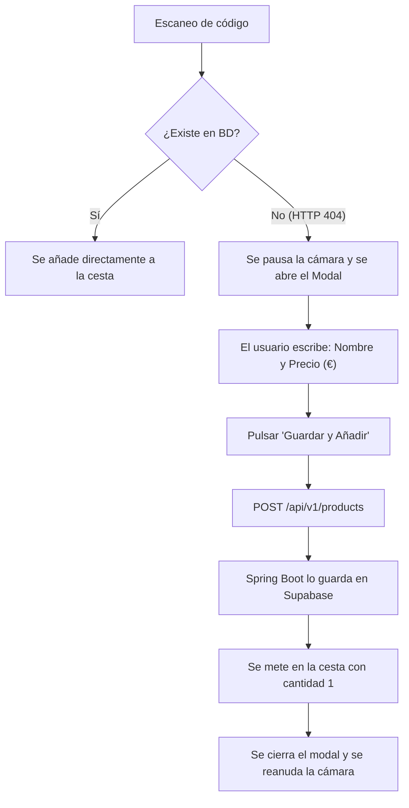
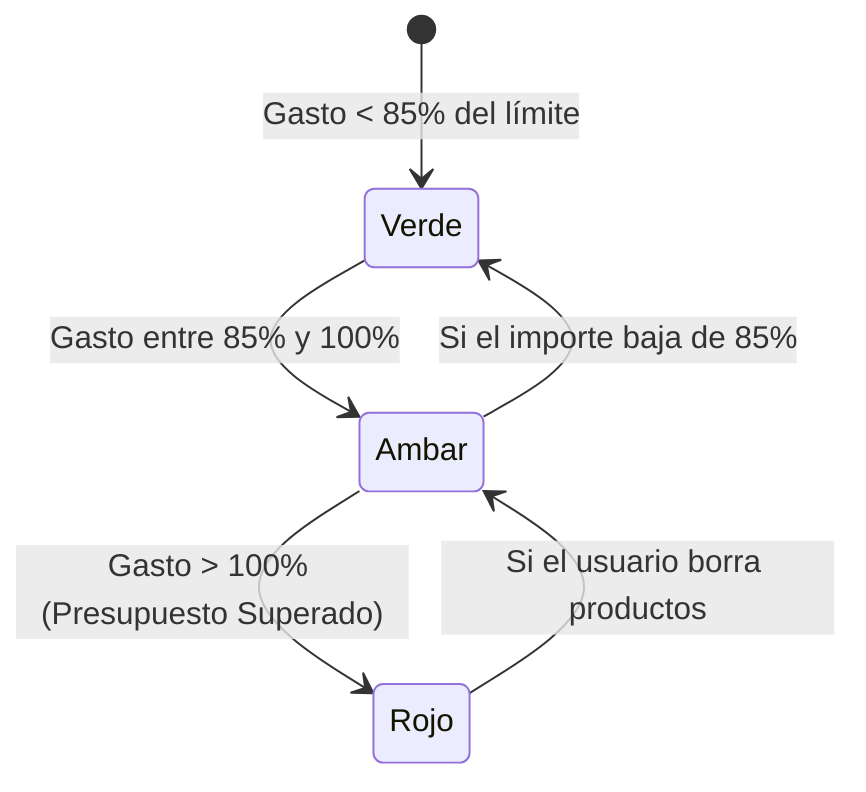
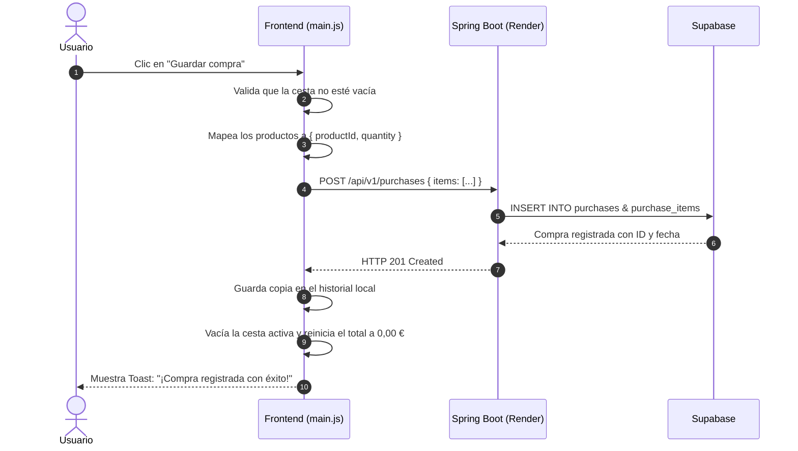

# 🛒 Mercat Asistent - Documentación Técnica del Proyecto

Documentación técnica y funcional de **Mercat Asistent**, una Progressive Web App (PWA) diseñada para el escaneo de productos mediante código de barras en tiempo real, cálculo de totales y control de presupuesto para compras de supermercado.

---

## 📑 Índice de Contenidos

1. [¿Qué es Mercat Asistent?](#1-qué-es-mercat-asistent)
2. [Conceptos Básicos: ¿Qué es una PWA?](#2-conceptos-básicos-qué-es-una-pwa)
3. [Arquitectura General del Sistema](#3-arquitectura-general-del-sistema)
4. [Estructura del Código Fuente](#4-estructura-del-código-fuente)
5. [Diagramas de Flujo y Secuencia](#5-diagramas-de-flujo-y-secuencia)
   - [A. Flujo del Escaneo y Detección de Códigos de Barras](#a-flujo-del-escaneo-y-detección-de-códigos-de-barras)
   - [B. Alta de Productos No Encontrados (Gestión de 404)](#b-alta-de-productos-no-encontrados-gestión-de-404)
   - [C. Control Visual del Presupuesto (Semáforo didáctico)](#c-control-visual-del-presupuesto-semáforo-didáctico)
   - [D. Guardado de la Compra en Supabase](#d-guardado-de-la-compra-en-supabase)
6. [Módulos JavaScript Explicados](#6-módulos-javascript-explicados)
7. [Integración con la API REST (Spring Boot en Render)](#7-integración-con-la-api-rest-spring-boot-en-render)
8. [Cómo Ejecutar el Proyecto en Local](#8-cómo-ejecutar-el-proyecto-en-local)
9. [Guía de Despliegue en GitHub Pages](#9-guía-de-despliegue-en-github-pages)

---

## 1. ¿Qué es Mercat Asistent?

**Mercat Asistent** es un asistente de compras inteligente enfocado a supermercados (inspirado en la experiencia de compra en Mercadona). 

Permite que el comprador, usando la cámara de su propio smartphone:
1. **Escanee el código de barras (EAN-13)** de cada producto antes de introducirlo en el carrito físico.
2. **Obtenga al instante el nombre y precio oficial** guardado en la base de datos.
3. **Calcule el total acumulado en tiempo real**, evitando sorpresas desagradables al llegar a la caja.
4. **Controle su presupuesto máximo**: la app avisa mediante colores (verde, amarillo y rojo) cuando se acerca o supera el límite fijado.
5. **Registre productos nuevos al vuelo**: si escanea un producto que aún no existe en el catálogo, la app le permite escribir su nombre y precio para guardarlo automáticamente en la nube.
6. **Finalice y archive la compra**: al pulsar "Guardar compra", se envía el desglose completo a la base de datos para su registro histórico.

---

## 2. Conceptos Básicos: ¿Qué es una PWA?

Una **PWA (Progressive Web App o Aplicación Web Progresiva)** es una página web moderna construida con tecnologías estándar (HTML, CSS y JavaScript) que se comporta de cara al usuario como si fuera una aplicación nativa instalada desde Google Play o Apple App Store.

### ¿Por qué elegimos una PWA en lugar de una App nativa tradicional?
| Ventaja | PWA (Nuestra solución) | App Nativa Tradicional |
| :--- | :--- | :--- |
| **Instalación** | Instantánea desde el navegador ("Añadir a pantalla de inicio") | Requiere descargas pesadas desde tiendas oficiales |
| **Costes y Publicación** | Despliegue gratuito en GitHub Pages en segundos | Comisiones anuales de desarrollador (Apple/Google) y esperas de aprobación |
| **Acceso a Hardware** | Accede a la cámara trasera y vibrador mediante APIs estándar del navegador (`getUserMedia`, `navigator.vibrate`) | Requiere configuración compleja de permisos nativos |
| **Capacidad Offline** | Funciona sin internet gracias al **Service Worker** | Requiere bases de datos nativas locales (Room / SQLite) |

---

## 3. Arquitectura General del Sistema

El ecosistema completo está diseñado de forma **desacoplada (frontend y backend separados)**, lo que permite que cada parte evolucione de manera independiente:

```mermaid
flowchart TD
    subgraph FrontendApp ["1. Frontend (PWA en el Móvil)"]
        Scanner["Cámara Web (html5-qrcode)"]
        UI["Interfaz Didáctica (Tailwind CSS)"]
        CartState["Cesta y Presupuesto (LocalStorage)"]
        SW["Service Worker (sw.js)"]
    end

    subgraph Hosting ["2. Alojamiento Frontend"]
        GHP["GitHub Pages (HTTPS Gratuito)"]
    end

    subgraph BackendSystem ["3. Backend en la Nube"]
        Render["API REST Spring Boot (Render)"]
        DB[(Base de Datos PostgreSQL en Supabase)]
    end

    GHP -.->|Descarga inicial de archivos| FrontendApp
    Scanner -->|1. Lee código EAN-13| UI
    UI <-->|2. Guarda cesta temporal| CartState
    UI <-->|3. Consultas HTTP REST (JSON)| Render
    Render <-->|4. Persistencia SQL / JPA| DB
```

---

## 4. Estructura del Código Fuente

El proyecto sigue una estructura limpia, modular y fácil de entender por cualquier desarrollador:

```text
Mercat_front/
├── public/
│   ├── manifest.webmanifest   # Metadatos para instalar la PWA en el móvil
│   ├── sw.js                  # Service Worker (caché y soporte offline)
│   └── icons/
│       └── icon.svg           # Icono de la aplicación en alta resolución
├── src/
│   ├── css/
│   │   └── style.css          # Estilos Tailwind + animaciones didácticas
│   ├── js/
│   │   ├── api.js             # Todas las peticiones HTTP (fetch) al backend
│   │   ├── scanner.js         # Lógica de la cámara, linterna y lectura EAN
│   │   ├── cart.js            # Estado de la cesta, cálculo de totales
│   │   ├── budget.js          # Control de presupuesto y semáforos de color
│   │   └── modals.js          # Control de paneles deslizables (Drawers)
│   └── main.js                # Orquestador principal (conecta todo)
├── .env                       # Variables de entorno (URL del backend)
├── index.html                 # Maqueta visual principal
├── tailwind.config.js         # Paleta de colores corporativos y espaciados
├── vite.config.js             # Configuración del empaquetador Vite
└── package.json               # Dependencias y scripts de ejecución
```

---

## 5. Diagramas de Flujo y Secuencia

### A. Flujo del Escaneo y Detección de Códigos de Barras



---

### B. Alta de Productos No Encontrados (Gestión de 404)

Cuando vas por el pasillo del supermercado y encuentras un producto recién lanzado o que aún no tienes en tu base de datos:



---

### C. Control Visual del Presupuesto (Semáforo didáctico)

La barra inferior utiliza tres rangos de color claramente diferenciados:



- **Verde (`#00652c`):** Todo en orden, compra dentro de lo planificado.
- **Ámbar (`#f59e0b`):** Advertencia didáctica: estás a punto de alcanzar tu tope de gasto.
- **Rojo (`#ba1a1a`):** Alerta visual: te has pasado de tu presupuesto asignado.

> [!TIP]
> **Configuración y Persistencia:** El límite de presupuesto se puede regular mediante la barra deslizadora (de 1 € a 200 € en saltos de 5 €) o tecleando cualquier cantidad exacta incluyendo céntimos (ej. `45.50 €`). La aplicación recuerda automáticamente el último presupuesto configurado en el teléfono (`localStorage`), evitando tener que redefinirlo en cada compra.

---

### D. Guardado de la Compra en Supabase

Al pulsar el botón principal **"Guardar compra"**:



---

## 6. Módulos JavaScript de la Aplicación

El proyecto se estructura en módulos especializados para mantener una arquitectura limpia y desacoplada:

1. **`src/js/api.js`:**
   - Contiene las funciones `fetch` que hablan con Render.
   - Incluye la función `pingBackend()`, que realiza una llamada silenciosa al abrir la app para "despertar" el servidor de Render antes de que el usuario escanee su primer producto.
2. **`src/js/scanner.js`:**
   - Controla la cámara y la decodificación en tiempo real mediante `html5-qrcode`.
   - Activa aceleración nativa por hardware (`BarcodeDetector` en C++/GPU en navegadores compatibles) y muestreo a 20 FPS con marco de lectura enfocado (`qrbox`), optimizando el rendimiento en procesadores móviles.
   - Decodifica tanto códigos de barras lineales tradicionales (EAN-13, EAN-8, UPC, Code 128) como códigos QR dinámicos de Mercadona (GS1 Digital Link para productos de peso variable en carne/pescado), extrayendo el GTIN y el precio inyectado.
   - Incorpora protección anti-duplicados: pausa inmediata al detectar el producto, reanudación automática tras 1.8 segundos y tiempo de enfriamiento de 3.5 segundos para evitar lecturas repetidas si el usuario mantiene el producto frente a la cámara.
   - Proporciona control de linterna (*torch*) y feedback sensorial sutil (*Beep* sintético Web Audio y vibración háptica).
3. **`src/js/cart.js`:**
   - Gestiona el array de productos de la compra activa.
   - Guarda los cambios en `localStorage` inmediatamente para no perder la compra si la pantalla del móvil se apaga.
   - Calcula subtotales y formatea los números con coma decimal europea y símbolo de euro (`3,50 €`).
4. **`src/js/budget.js`:**
   - Gestiona el presupuesto configurable por el usuario entre 1 € y 200 € (con soporte para céntimos).
   - Recuerda automáticamente el último límite configurado en el almacenamiento local del teléfono (`localStorage`).
   - Evalúa el porcentaje consumido y determina los estados de alerta visual (verde, ámbar y rojo).
5. **`src/js/modals.js`:**
   - Controla la apertura y cierre suave de los paneles inferiores mediante transiciones de Tailwind CSS.
6. **`src/main.js`:**
   - Conecta todos los módulos anteriores, gestiona los clics de botones y arranca la aplicación.

---

## 7. Integración con la API REST (Spring Boot en Render)

El backend expone los siguientes endpoints que consume este frontend:

| Método | Endpoint | Descripción | Cuerpo de Petición (Body) |
| :--- | :--- | :--- | :--- |
| **GET** | `/api/v1/products/by-barcode/{barcode}` | Consulta producto por código | *Ninguno* |
| **POST** | `/api/v1/products` | Crea un nuevo producto | `{"barcode": "...", "name": "...", "price": 1.50}` |
| **PUT** | `/api/v1/products/{barcode}` | Modifica un producto existente | `{"barcode": "...", "name": "...", "price": 1.70}` |
| **GET** | `/api/v1/products` | Lista catálogo completo | *Ninguno* |
| **POST** | `/api/v1/purchases` | Registra una compra finalizada | `{"items": [{"productId": 3, "quantity": 2}]}` |
| **GET** *(Propuesto)* | `/api/v1/products/search?q={texto}` | Sugerencias en tiempo real mientras el usuario escribe | *Ninguno* |

### 💡 Diseño Didáctico: Endpoint de Sugerencias en Spring Boot
Para implementar el desplegable de autocompletado cuando el usuario escribe letras en el buscador:

1. **En `ProductRepository.java` (Spring Data JPA):**
   ```java
   // Busca hasta 6 productos cuyo nombre contenga el texto ignorando mayúsculas/minúsculas
   List<Product> findTop6ByNameContainingIgnoreCase(String name);
   ```

2. **En `ProductService.java`:**
   ```java
   public List<ProductDTO> searchSuggestions(String query) {
       if (query == null || query.trim().length() < 2) {
           return Collections.emptyList();
       }
       return productRepository.findTop6ByNameContainingIgnoreCase(query.trim())
               .stream()
               .map(this::mapToDTO)
               .toList();
   }
   ```

3. **En `ProductController.java`:**
   ```java
   @GetMapping("/search")
   public ResponseEntity<List<ProductDTO>> getSuggestions(@RequestParam("q") String query) {
       return ResponseEntity.ok(productService.searchSuggestions(query));
   }
   ```

> [!NOTE]
> **CORS (Cross-Origin Resource Sharing):** Tu backend de Spring Boot ya incluye la cabecera `Access-Control-Allow-Origin: *`, por lo que el frontend puede ser alojado en cualquier dominio (incluyendo GitHub Pages) sin sufrir bloqueos de seguridad del navegador.

---

## 8. Cómo Ejecutar el Proyecto en Local

Si un compañero desea clonar o probar el proyecto en su propio ordenador:

### Requisitos previos:
- Tener instalado **Node.js** (versión 18 o superior).

### Pasos:
1. Abrir una terminal en la carpeta del proyecto:
   ```powershell
   cd C:\Users\HULIGAN\Desktop\Mercat_front
   ```
2. Instalar las dependencias (solo la primera vez):
   ```powershell
   npm install
   ```
3. Iniciar el servidor de desarrollo local:
   ```powershell
   npm run dev
   ```
4. El navegador se abrirá en `http://localhost:3000`.

---

## 9. Guía de Despliegue en GitHub Pages

Para publicar tu aplicación de forma que cualquier persona pueda abrirla en su teléfono móvil con HTTPS:

### Paso 1: Generar la versión de producción optimizada
En la terminal, ejecuta:
```powershell
npm run build
```
Esto creará una carpeta llamada `dist/` con todo el código HTML, CSS, JavaScript e iconos minificados y optimizados.

### Paso 2: Subir los cambios a GitHub
*(Recuerda que no ejecutamos comandos de Git de forma automática por las reglas de seguridad de este proyecto; puedes ejecutarlos tú mismo en tu terminal cuando lo desees)*:

```bash
git add .
git commit -m "feat: Mercat Asistent PWA completa conectada con Render y Supabase"
git branch -M main
git remote add origin https://github.com/Huligan-spring/Mercat_front.git
git push -u origin main
```

### Paso 3: Activar GitHub Pages en el repositorio
1. Entra en tu repositorio en GitHub: [https://github.com/Huligan-spring/Mercat_front](https://github.com/Huligan-spring/Mercat_front)
2. Ve a la pestaña **Settings** (Configuración) > **Pages** (en el menú lateral izquierdo).
3. En **Build and deployment** > **Source**, puedes elegir:
   - Opción directa con GitHub Actions (Workflow de Vite).
   - O seleccionar la rama que contiene la carpeta `dist`.
4. Una vez activado, tu aplicación estará disponible públicamente en:
   **`https://huligan-spring.github.io/Mercat_front/`**

¡Listo! Al abrir esa URL desde Google Chrome en Android o Safari en iPhone, aparecerá el aviso **"Instalar aplicación en la pantalla de inicio"** para usarla en el supermercado como una app nativa.
