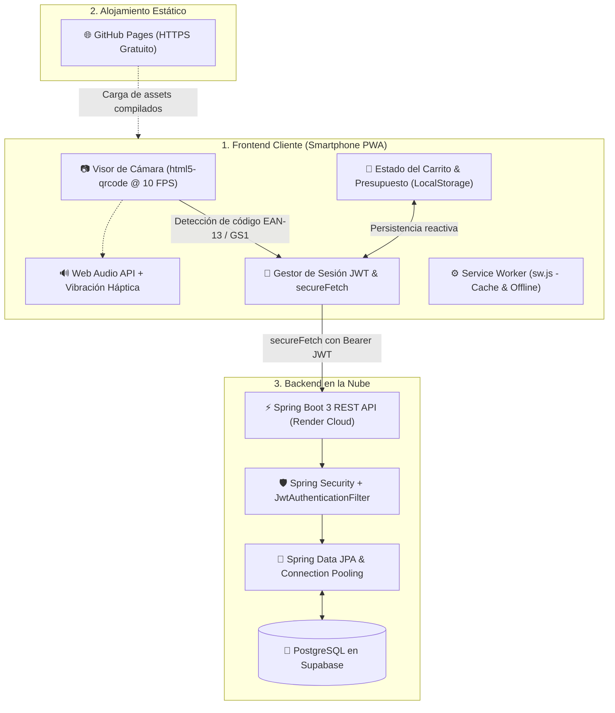
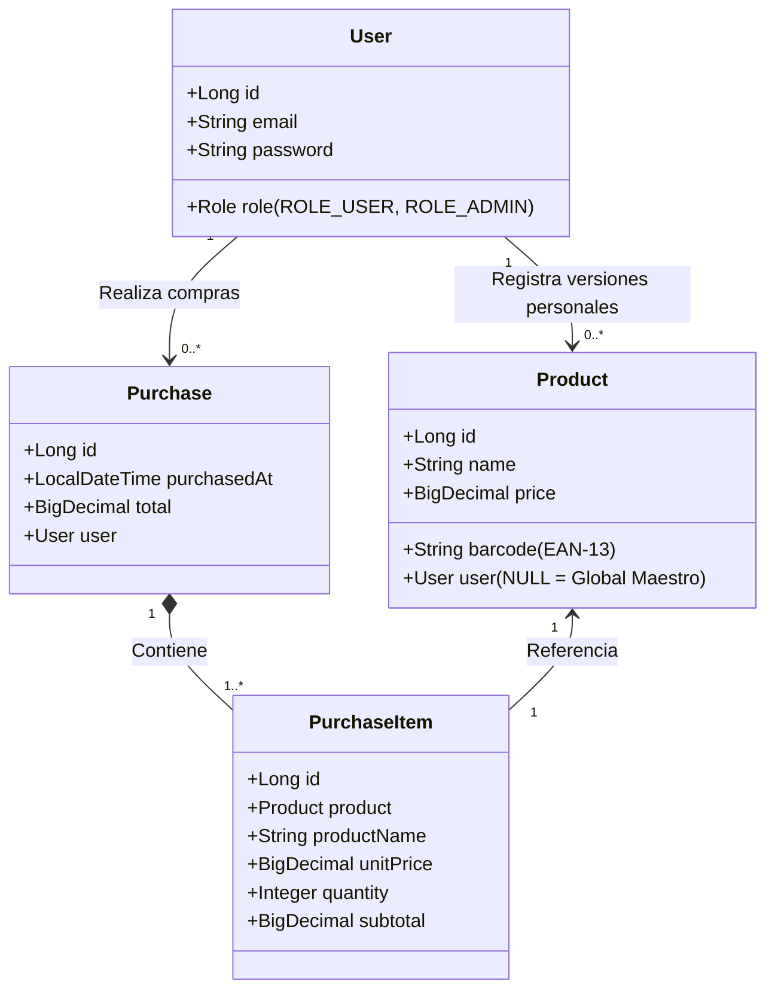
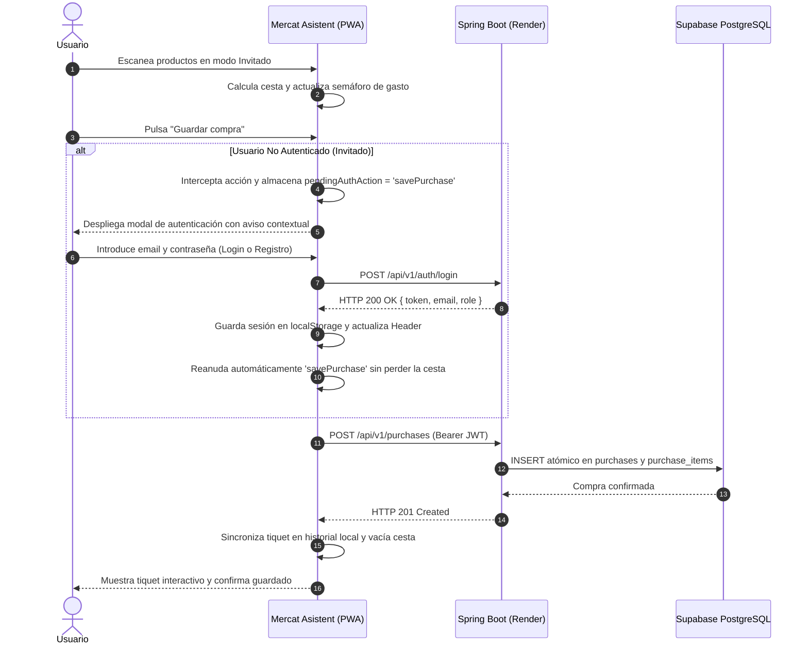
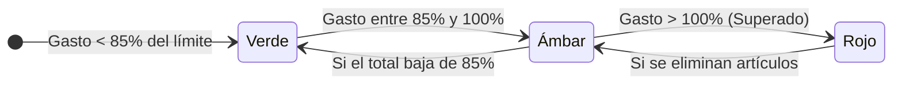

# 🛒 Mercat Asistent — Asistente Inteligente de Compras & Escáner PWA

<div align="center">


[](https://vitejs.dev/)
[](https://tailwindcss.com/)
[](https://spring.io/projects/spring-boot)
[](https://supabase.com/)
[](https://render.com/)
[](LICENSE)

**Tu compañero de compras en el supermercado: escaneo omnidireccional de códigos de barras en tiempo real, control presupuestario mediante semáforo didáctico, catálogo híbrido multiusuario y sincronización en la nube.**

[Demo en Vivo (GitHub Pages)](https://huligan-spring.github.io/Mercat_front/) • [Explorar la API](#-matriz-de-endpoints-rest) • [Instalación Local](#-puesta-en-marcha-en-local)

</div>

---

## 📖 Índice

1. [El Problema y la Solución](#-el-problema-y-la-solución)
2. [Características Destacadas](#-características-destacadas)
3. [Arquitectura del Sistema](#-arquitectura-del-sistema)
4. [Ingeniería Óptica y Control de Hardware](#-ingeniería-óptica-y-control-de-hardware)
5. [Modelo de Catálogo Híbrido & Seguridad JWT](#-modelo-de-catálogo-híbrido--seguridad-jwt)
6. [Flujo Just-In-Time (JIT) & Resiliencia ante Cold Start](#-flujo-just-in-time-jit--resiliencia-ante-cold-start)
7. [Semáforo Didáctico de Presupuesto](#-semáforo-didáctico-de-presupuesto)
8. [Matriz de Endpoints REST](#-matriz-de-endpoints-rest)
9. [Estructura del Proyecto](#-estructura-del-proyecto)
10. [Puesta en Marcha en Local](#-puesta-en-marcha-en-local)
11. [Guía de Despliegue en GitHub Pages](#-guía-de-despliegue-en-github-pages)

---

## 🎯 El Problema y la Solución

### El Dilema en el Pasillo del Supermercado
Al hacer la compra semanal, el consumidor suele enfrentarse a una experiencia fragmentada:
- **Pérdida de control del gasto:** No se conoce el total acumulado hasta que la cajera pasa el último artículo por el lector, provocando sorpresas desagradables al pagar.
- **Falta de contexto sobre el límite:** Calcular mentalmente subtotales con decimales mientras se comparan productos resulta tedioso e inexacto.
- **Productos sin precio visible:** Etiquetas rotas, movidas o confusas en el lineal obligan a buscar verificadores de precios lejanos.
- **Barreras de registro innecesarias:** La mayoría de aplicaciones obligan a crear una cuenta antes de permitir siquiera probar el escáner.

### La Solución: Mercat Asistent
**Mercat Asistent** convierte el propio smartphone del usuario en un terminal inteligente de autoservicio:
- 📱 **Sin instalación pesada:** Funciona al instante en el navegador web como una PWA con soporte completo offline.
- ⚡ **Escaneo omnidireccional instantáneo:** Apunta al producto en horizontal o vertical; en menos de 100 ms el nombre y precio oficial se incorporan al carrito.
- 🚦 **Semáforo visual en tiempo real:** Una barra didáctica tricolor advierte si el gasto se mantiene dentro de los límites fijados antes de llegar a la caja.
- 🧩 **Catálogo Híbrido y Colaborativo:** Consulta un catálogo maestro central y permite registrar productos propios o precios personalizados si no existen.
- 🔓 **Modo invitado sin fricción:** Escanea y organiza tu cesta libremente; la app solo solicita inicio de sesión cuando deseas archivar tu ticket en la nube.

---

## ✨ Características Destacadas

| Funcionalidad | Descripción Técnica |
| :--- | :--- |
| **PWA Mobile-First** | Instalable en pantalla de inicio (Android / iOS), tema inmersivo `#00652c`, standalone sin barras de navegación del explorador. |
| **Escáner Omnidireccional** | Lector simétrico 260×260 con motor ZXing enfocado en EAN-13, EAN-8, UPC-A, QR Code y Data Matrix. |
| **Soporte GS1 Mercadona** | Decodificación nativa de QR GS1 Digital Link en carnicería y pescadería, extrayendo GTIN y precio variable inyectado. |
| **Feedback Sensorial** | Pitido (*Beep*) sintético a 1800 Hz generado en tiempo real vía Web Audio API + vibración háptica de 90 ms. |
| **Ahorro de Batería (10 FPS)** | Reduce el uso de CPU en un 50%, con suspensión en segundo plano (*Page Visibility API*) y reposo inteligente tras 2 min. |
| **Reactivación Automática** | Recuperación transparente de la cámara si el sistema operativo finaliza el stream de vídeo en reposo. |
| **Búsqueda Predictiva** | Entrada asistida con *debounce* de 250 ms conectada a Spring Data JPA para sugerencias de autocompletado en vivo. |
| **Seguridad JWT & Roles** | Aislamiento multi-inquilino en Spring Security 3 con roles diferenciados (`ROLE_USER` y `ROLE_ADMIN`). |
| **Autenticación Just-In-Time** | Invitado por defecto; solicita credenciales únicamente al guardar tiquets o publicar productos nuevos. |
| **Resiliencia ante Cold Start** | Reintento automático silencioso y feedback progresivo si el servidor en Render está saliendo de reposo. |
| **Historial Híbrido** | Carga instantánea desde `localStorage` y sincronización en segundo plano con Supabase sin duplicar tickets. |
| **Checklist Previa** | Bloc de notas integrado para preparar los artículos necesarios antes de salir de casa y tacharlos al comprar. |

---

## 🏛 Arquitectura del Sistema

El ecosistema adopta una arquitectura completamente **desacoplada**, separando el cliente PWA ligero del servidor empresarial en la nube:



---

## 📷 Ingeniería Óptica y Control de Hardware

### Escaneo Simétrico y Omnidireccional
A diferencia de los lectores convencionales que obligan al usuario a alinear el código perfectamente horizontal, Mercat Asistent implementa un visor cuadrado simétrico (`qrbox: 260x260` con relación de aspecto `1.0`). Esto permite que el motor de decodificación analice las líneas del código de barras tanto en horizontal como en vertical o en ángulos diagonales, reduciendo drásticamente el tiempo de reconocimiento.

### Decodificación de QR Dinámicos de Peso Variable
En productos de charcutería, carne o pescado envasados al peso (como los de Mercadona), el etiquetado no utiliza un EAN estándar de precio fijo, sino un **código QR dinámico GS1 Digital Link**:
```text
https://qrtrack.mercadona.es/01/08436581961300/...&3922=00415
```
Mercat Asistent analiza la cadena en tiempo real mediante expresiones regulares optimizadas:
1. Extrae el identificador global de producto (**GTIN** `08436581961300`).
2. Extrae el precio exacto codificado tras el identificador de aplicación `3922` (`00415` = **4,15 €**).
3. Añade el artículo a la cesta con su precio específico de báscula de forma totalmente desatendida.

### Gestión Inteligente de Batería y Cámara
- **10 FPS Eficientes:** Procesa únicamente 10 fotogramas por segundo, suficiente para una lectura sub-100 ms y ahorrando un 50% de batería frente a los 30-60 FPS estándar.
- **Liberación de Hardware:** El botón **On/Off** detiene el stream del sensor mediante `stopScanner()`, permitiendo que el usuario alterne hacia aplicaciones nativas de lectura de códigos de Android sin conflicto de recursos de la cámara.
- **Page Visibility API:** Si la pantalla se bloquea o el usuario cambia de aplicación, el visor se suspende al instante.
- **Reposo tras Inactividad & Recuperación de Stream:** Tras 2 minutos sin actividad, la cámara entra en reposo visual. Si el sistema operativo de Android/iOS llega a matar la pista de vídeo (`readyState === 'ended'`), el sistema descarta la instancia huérfana y relanza una captura limpia en menos de 300 ms al pulsar el botón o tocar la pantalla, **sin necesidad de recargar la página**.

---

## 🗄 Modelo de Catálogo Híbrido & Seguridad JWT

El sistema implementa una arquitectura de datos que combina la fiabilidad de un **catálogo oficial maestro** con la flexibilidad de un **catálogo personal**:



### Reglas de Prioridad en Búsquedas
1. **Con sesión activa (Bearer JWT):** El servidor consulta primero si el usuario tiene una versión personalizada del código (`user_id = user.id`). Si existe, se devuelve con máxima prioridad; si no existe, devuelve la versión oficial del catálogo maestro (`user_id IS NULL`).
2. **Modo Invitado (Sin Token):** El servidor consulta directamente el catálogo maestro global.
3. **Control de Autorización:**
   - Un usuario estándar (`ROLE_USER`) solo puede crear o editar artículos vinculados a su propia cuenta.
   - Solo los administradores (`ROLE_ADMIN`) tienen privilegios para crear o modificar productos con `makeGlobal: true` (`user_id = NULL`).

---

## ⚡ Flujo Just-In-Time (JIT) & Resiliencia ante Cold Start



### Resiliencia ante el Arranque en Frío (Render Cold Start)
En el plan gratuito de Render, el contenedor entra en suspensión tras 15 minutos sin peticiones. Mercat Asistent mitiga este comportamiento con tres estrategias:
1. **Comprobación Silenciosa al Inicio (`pingBackend`):** Al abrir la app, se envía una consulta ligera a `GET /api/v1/products/search?q=ping` para despertar la máquina en segundo plano antes de que el usuario llegue al primer producto.
2. **Reintento Automático Silencioso:** Si una llamada de autenticación falla con `TypeError: Failed to fetch` porque el socket del navegador agotó el tiempo mientras el contenedor arrancaba, la función `fetchWithColdStartRetry` efectúa automáticamente un segundo intento tras 1,5 segundos. Como el servidor ya terminó de levantar, la petición tiene éxito de inmediato.
3. **Feedback Progresivo:** Si la petición tarda más de 2,5 segundos, la interfaz informa dinámicamente: *"Despertando servidor en la nube..."*, evitando que el usuario piense que la aplicación se ha bloqueado.

---

## 🚦 Semáforo Didáctico de Presupuesto

La barra inferior ofrece una lectura visual inmediata del gasto acumulado frente al límite establecido por el comprador (regulable de 1 € a 200 € con slider táctil o entrada numérica precisa con céntimos):



- 🟢 **Verde Corporativo (`#00652c`):** Compra holgada dentro de lo planificado.
- 🟡 **Ámbar Preventivo (`#f59e0b`):** Advertencia: estás a punto de alcanzar el tope asignado.
- 🔴 **Rojo de Alerta (`#ba1a1a`):** Presupuesto superado; aviso visual para reevaluar artículos de la cesta.

---

## 📡 Matriz de Endpoints REST

La API REST desplegada en Render expone los siguientes servicios:

| Método | Endpoint | Autenticación Requerida | Descripción y Comportamiento |
| :---: | :--- | :---: | :--- |
| **POST** | `/api/v1/auth/register` | Pública | Registra nuevo usuario (`email`, `password`). Devuelve `201 Created` con `{ token, email, role }`. |
| **POST** | `/api/v1/auth/login` | Pública | Valida credenciales con BCrypt. Devuelve `200 OK` con `{ token, email, role }`. |
| **GET** | `/api/v1/products/by-barcode/{code}` | Opcional (`Bearer <token>`) | Prioriza catálogo personal sobre el maestro global. Modo invitado consulta catálogo global. |
| **GET** | `/api/v1/products/search?q={query}` | Opcional (`Bearer <token>`) | Autocompletado en vivo: devuelve hasta 6 sugerencias sin códigos duplicados. |
| **POST** | `/api/v1/products` | Obligatoria (`Bearer <token>`) | Crea/actualiza producto propio (o global maestro si el usuario posee `ROLE_ADMIN` y `makeGlobal: true`). |
| **DELETE**| `/api/v1/products/{code}` | Obligatoria (`Bearer <token>`) | Elimina el producto personalizado del usuario autenticado. |
| **POST** | `/api/v1/purchases` | Obligatoria (`Bearer <token>`) | Registra la compra en Supabase asociada al `user_id` del token JWT. |
| **GET** | `/api/v1/purchases` | Obligatoria (`Bearer <token>`) | Devuelve el historial exclusivo de tiquets del usuario autenticado. |

---

## 📂 Estructura del Proyecto

```text
Mercat_front/
├── public/
│   ├── manifest.webmanifest      # Manifiesto de instalación PWA (Standalone, tema #00652c)
│   ├── sw.js                     # Service Worker (Estrategias Network-First & Cache-First)
│   └── icons/
│       └── icon.svg              # Isotipo vectorial de alta fidelidad
├── src/
│   ├── css/
│   │   └── style.css             # Directivas de Tailwind CSS y animaciones táctiles
│   ├── js/
│   │   ├── auth.js               # Almacenamiento de tokens JWT, roles y wrapper secureFetch
│   │   ├── api.js                # Cliente HTTP REST, pingBackend y reintento ante arranque en frío
│   │   ├── scanner.js            # Motor de cámara html5-qrcode, linterna y decodificación GS1
│   │   ├── cart.js               # Cálculo de totales, cantidades y persistencia de cesta activa
│   │   ├── budget.js             # Lógica del semáforo tricolor y control de presupuesto
│   │   └── modals.js             # Gestión de paneles deslizables (Drawers) y notificaciones Toast
│   └── main.js                   # Orquestador principal, flujos JIT y ciclo de vida de la PWA
├── .env                          # Configuración de variables de entorno (URL del backend en Render)
├── index.html                    # Maqueta HTML5 semántica y accesible con Tailwind CSS
├── tailwind.config.js            # Paleta de colores institucionales y escalas tipográficas
├── vite.config.js                # Configuración de empaquetado optimizado con Vite
└── package.json                  # Dependencias y scripts de compilación
```

---

## 🚀 Puesta en Marcha en Local

### Requisitos Previos
- **Node.js** v18.0.0 o superior instalado en el equipo.
- Gestor de paquetes **npm** (incluido con Node.js).

### Instalación y Ejecución

1. **Clonar el repositorio:**
   ```bash
   git clone https://github.com/Huligan-spring/Mercat_front.git
   cd Mercat_front
   ```

2. **Instalar dependencias:**
   ```bash
   npm install
   ```

3. **Configurar variables de entorno (opcional):**
   El archivo `.env` ya viene preconfigurado con la instancia activa en la nube:
   ```env
   VITE_API_BASE_URL=https://mercat-backend-6mxo.onrender.com/api/v1
   ```
   *(Si deseas apuntar a un backend local en Spring Boot, cámbialo a `http://localhost:8080/api/v1`)*.

4. **Iniciar el servidor de desarrollo:**
   ```bash
   npm run dev
   ```
   La aplicación se abrirá en `http://localhost:3000`.

5. **Compilar para producción:**
   ```bash
   npm run build
   ```
   Los archivos estáticos minificados y listos para distribución se generarán en la carpeta `dist/`.

---

## 🌐 Guía de Despliegue en GitHub Pages

Para publicar tu propia versión pública con certificado HTTPS gratuito (imprescindible para que el navegador móvil otorgue permisos de cámara):

1. **Generar la carpeta de distribución optimizada:**
   ```powershell
   npm run build
   ```

2. **Subir los cambios al repositorio remoto en GitHub:**
   ```bash
   git add .
   git commit -m "feat: publicacion de la version de produccion de Mercat Asistent"
   git push origin main
   ```

3. **Configurar GitHub Pages:**
   - En tu repositorio de GitHub, entra en **Settings** > **Pages** (menú lateral izquierdo).
   - En la sección **Build and deployment** > **Source**, selecciona la rama que contiene la carpeta `dist` (o configura una GitHub Action de despliegue con Vite).
   - Tras unos segundos, tu PWA estará disponible en:
     `https://<tu-usuario>.github.io/Mercat_front/`

---

<div align="center">

Hecho con dedicación para transformar la experiencia de compra en el supermercado.  
**Mercat Asistent** • Código abierto bajo [Licencia MIT](LICENSE)

</div>
